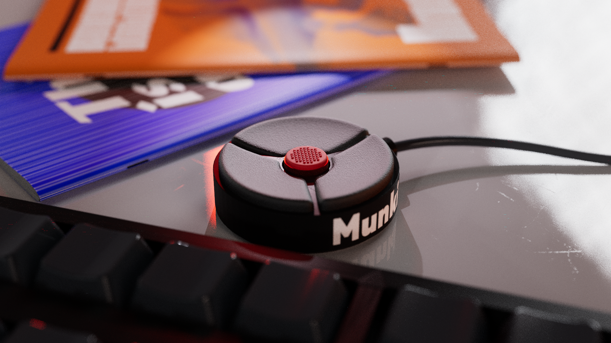
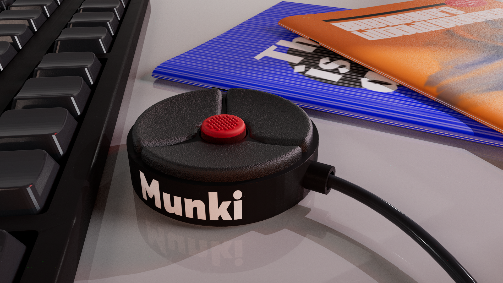
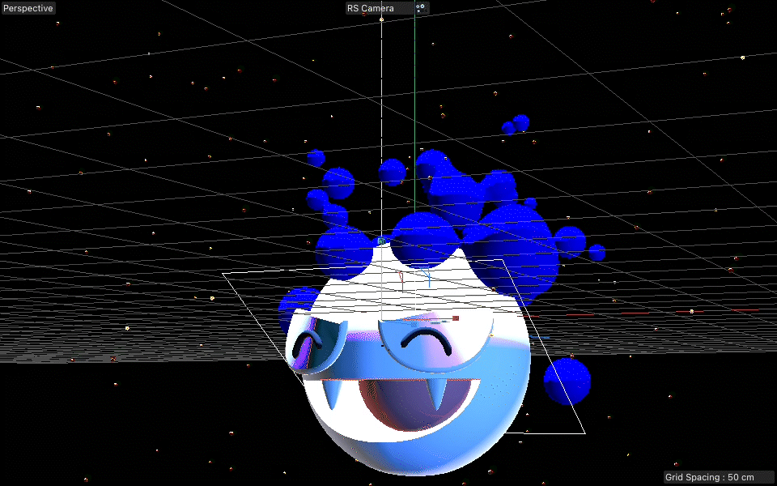
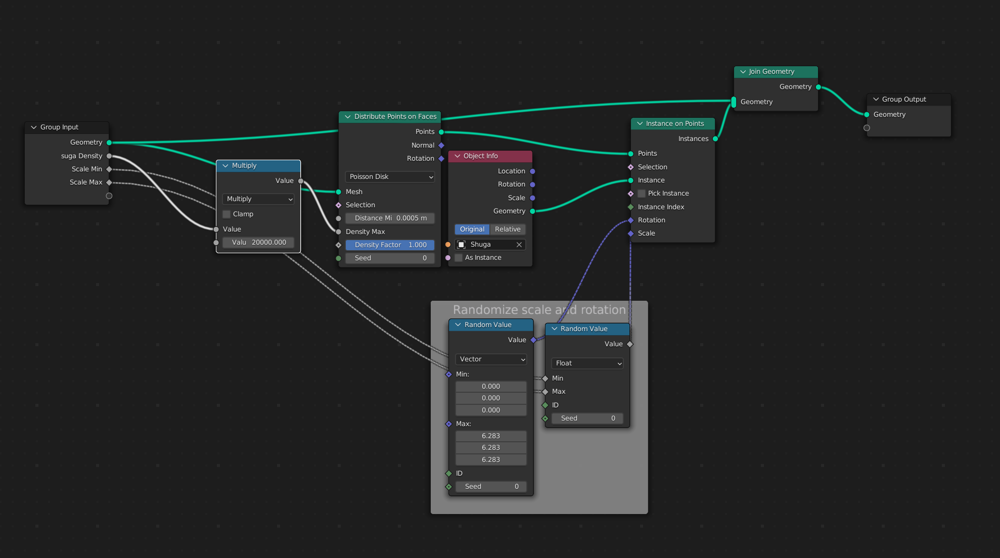
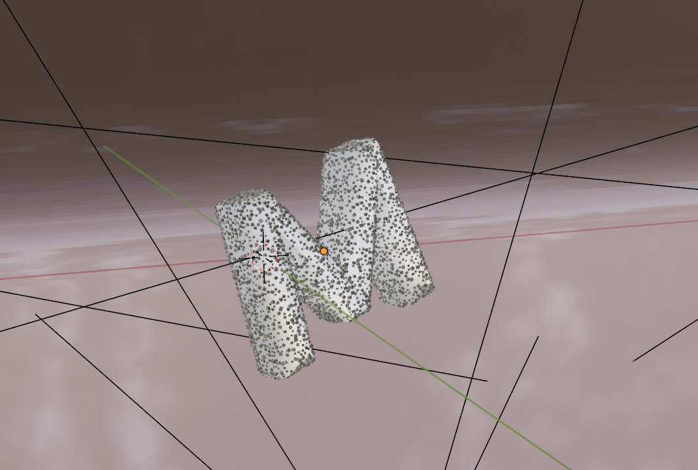
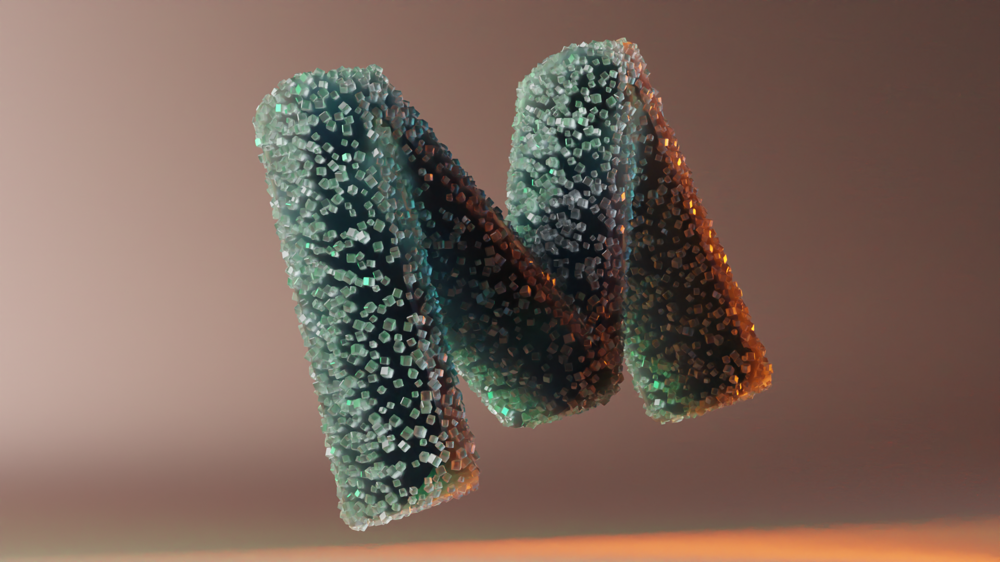
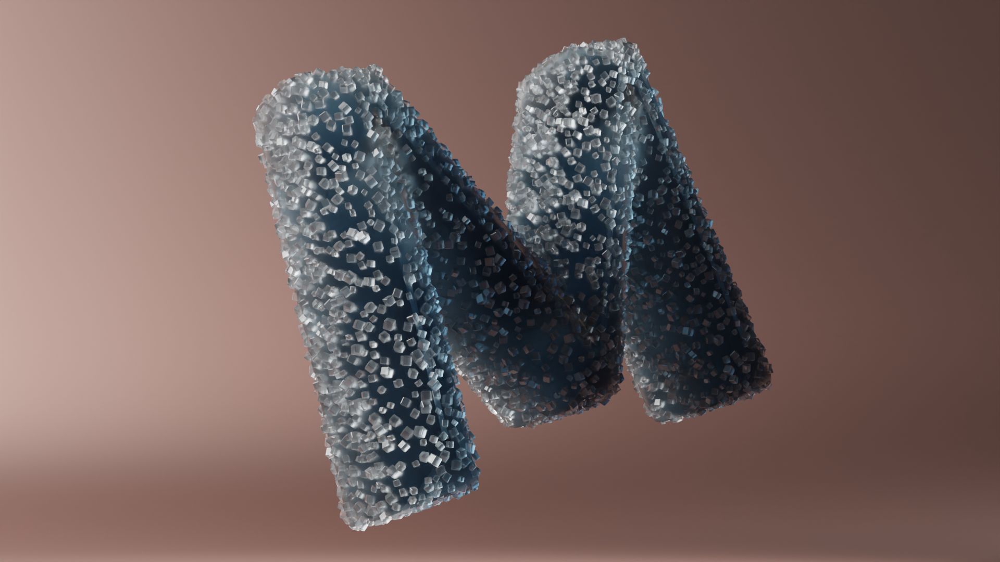
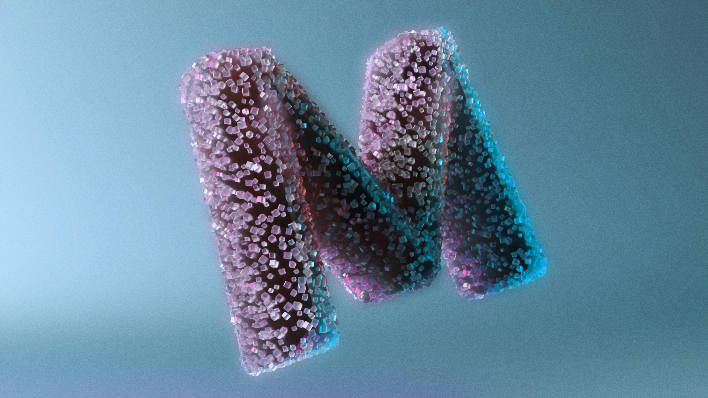

# Experiment Dump

Original URL: /Experiment-Dump

# Dhruv’s experiment dump

## Thanks for visiting, hope you have a good time here !

This page might be slow to load due to it’s experimental nature

Click to play

## **Now You see me**

An experiment with the Variable typeface Anek by Ektype foundry

I wanted to experiment with Dithering, specifically Steinberg Dithering to see what can be made with it.

Tools used :  C4D, Processing, AE, PS.

* * *

 

## **Munki Trackball for a Smaller world**

One fine day I thought what would the world would look like of Trackpoints took over, as opposed to the more widely available mice.

Tools used :  Blender, C4D, Redshift

* * *

A small experiment within P5.js to build generative patterns that changes with each refresh. Inspired by patterns in the sand.

* * *

Click and Drag to move around!

## **Scanned model of Sir Luke Ludipolos Skywalker,**

NeRf modelled with **LumaDev.**
It’s incredible that this came out of a bunch of images!

Luke did not concent to this, but he also didn’t not consent to it.

* * *

## **Ghastly - but better?**

A rendering I did of my favorite pokemon,

I wanted to explore emmiters, Metaballs and subsurface scattering (SSS) in C4D

If you love ghastly as much as me, download [some still renders](https://github.com/switchcrit/Goodies/tree/main/Ghastly_Downloads)[ here!](https://github.com/switchcrit/Goodies/tree/main/Ghastly_Downloads)

Tools used :C4D, redshft

Click to play

 

  

## **The-M jelly crystals**

An exploration of the node based Geometry in Blender.
I’ve made this file [available to download here](https://github.com/switchcrit/Goodies/tree/main/The%20M%20sugar%20crystals), incase you wanna use it in your projects!

Tools used: Blender

# More to come!

* * *

## [︎ Home](Mibby)

## [Projects ︎](Mibby)

All rights Reserved. 2014 - 2022 | Dhruv Sanjiv Srivastava

