# I_will_be_fine

Original URL: /I_will_be_fine

# I will be fine

An audio Installation

## Overview

As a part of the Staging exercise at NMD, we were tasked with designing an experience. The video below is a my attempt to document what it feels like to be at the installation.

A good pair of Headphones are recommended.

## Concept note:

At the bottom of every well, lies hope. The solace in the fact that, at the very bottom the only way left is up. That is what the sculpture tries to highlight.

An extremely minimal piece, “I will be fine” is an audio sculpture that relies on your ears more than your eyes. It is an experience that you slowly uncover as you move through a space, walking closer and close to this “cut”.

The 7 foot sculpture sits bare on the wall, open for the viewer to see it up close or even touch it. The space also includes a bench that allows the viewer to sit and listen to the audio loop play. Viewers may choose to listen to the whole audio experience more than once, that is if they choose to. Although, hearing it more than once is encouraged.

The sculpture was birthed by the idea the _unscratchable_ itch, this itch we have to fix everything according to our liking. The human need for control, over our actions, and the reaction of others: and the failure to achieve it resulting in this downward spiral. This itch often manifests itself as voices in your head, voices that come from wounds. Wounds of unfulfilled expectations, desires and needs. Voices that are in your head, but the voices are not you.

At it's core, “I will be fine” is an attempt to ground the viewer. To ground them in our shared pains. It is an attempt to normalise feelings of inadequacy, something we often end up forgetting. It is a reminder to notice the voice as an other, that sits within. Lastly, it is a reminder in our human resilience, because whatever it is, you will be fine.

* * *

## About

The Installation with the help of a camera blob tracks the viewer’s position in 3D space.

Triggering loops of the different sounds.

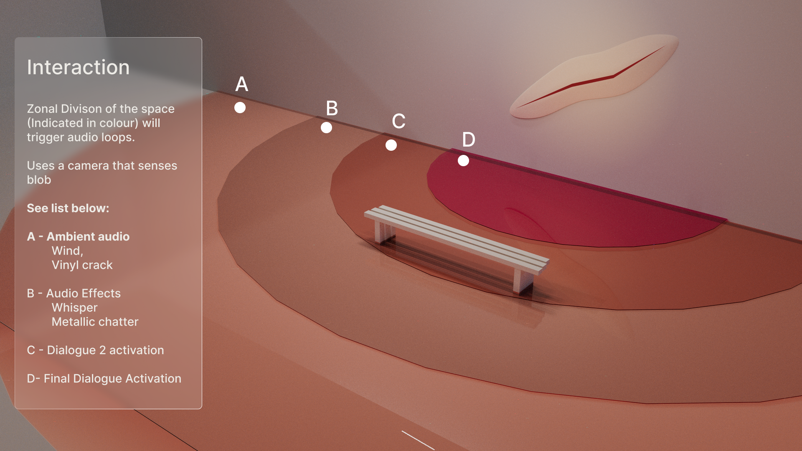

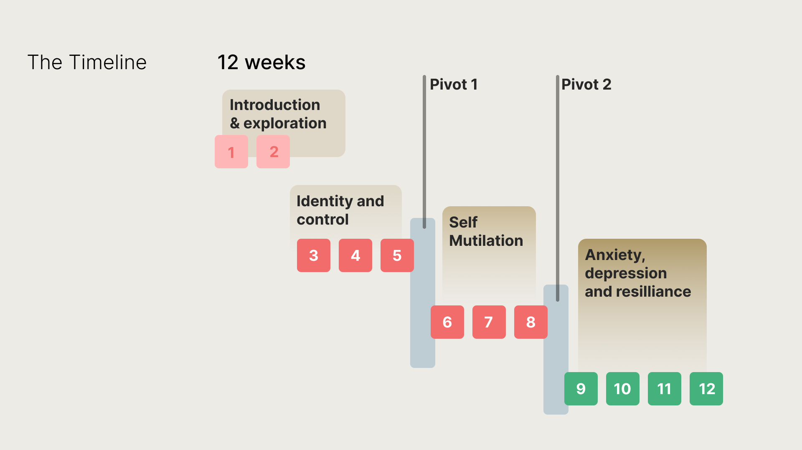

To arrive at the final product, I went through multiple experiments and 2 installations and different challenges they posed.

Areas that were explored included Plastic surgery, zoom dysmorphia, face filters, etc.

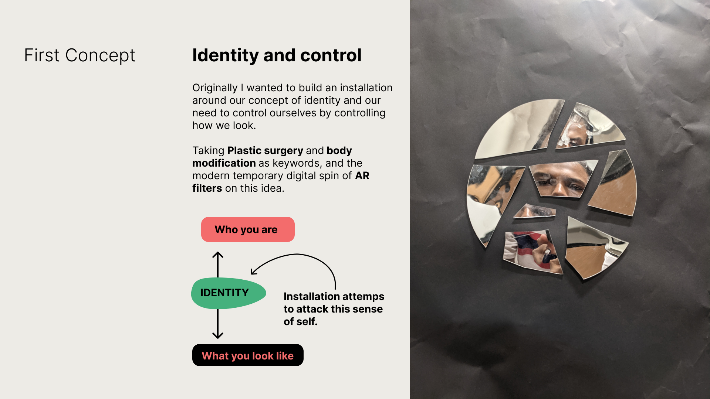 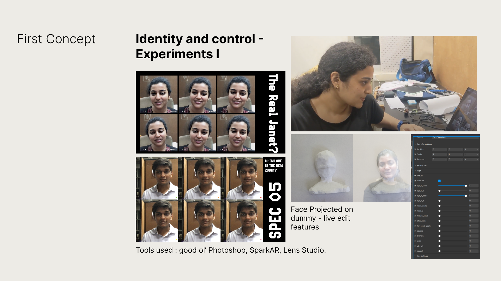 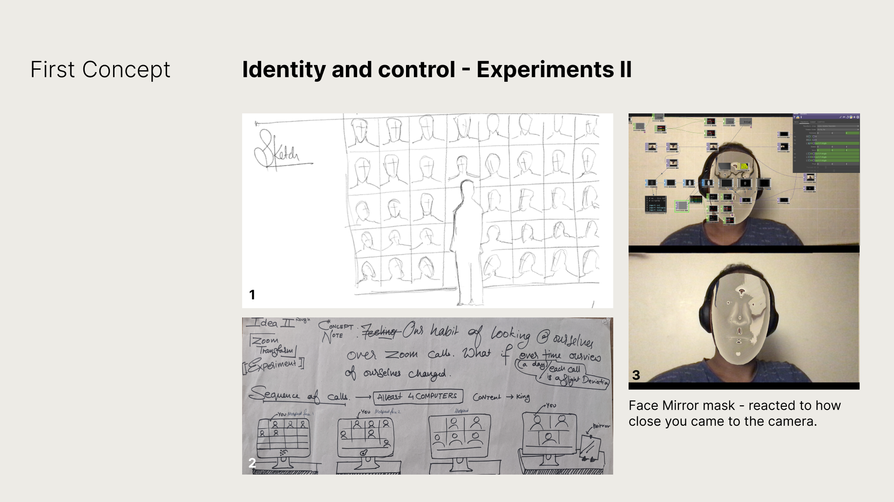

Experiements at this stage attempted to induce dysmorphia, and a state of uncertainity.

## Diving Deeper

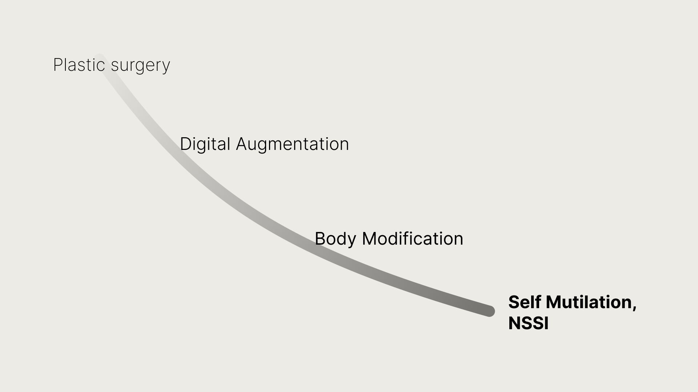

After looking a set of these experiments, I wanted to explore the other end of the spectrum, the more permanent aspect of this need for control.

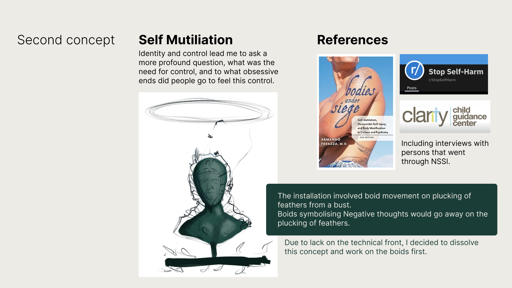

The second concept included the idea of **boids** , you can see a short video of an installation that this set of readings instilled.

Boids: These software creatures that would attack you like negative thoughts. When you are on the left and are calm and peaceful when you go to the right.

Music Introduction - This was the first experiment which involved music.
Warning!: it might get loud.

Tools used: Processing + Kinect + Media Pipe + Ableton Live

## An evolution on the previous installation.

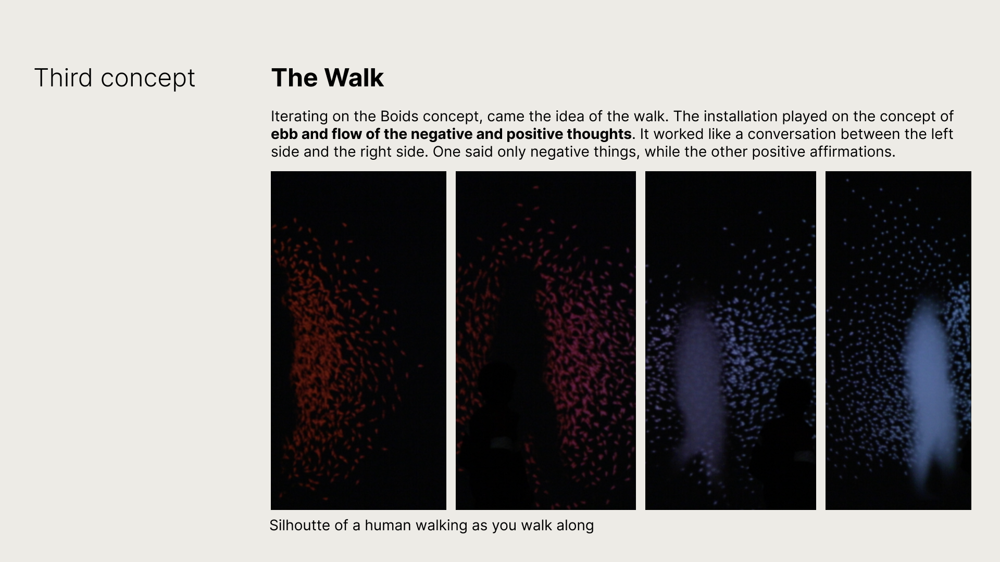

## The Final Installation Process

The final prototype emerged from this aretefct made to explore the cut, an allegory for self harm

The final prototype included multiple versions, from a small prototype to a large 7 foot hand made one and finally a CNC machined version, you can see the various versions below.

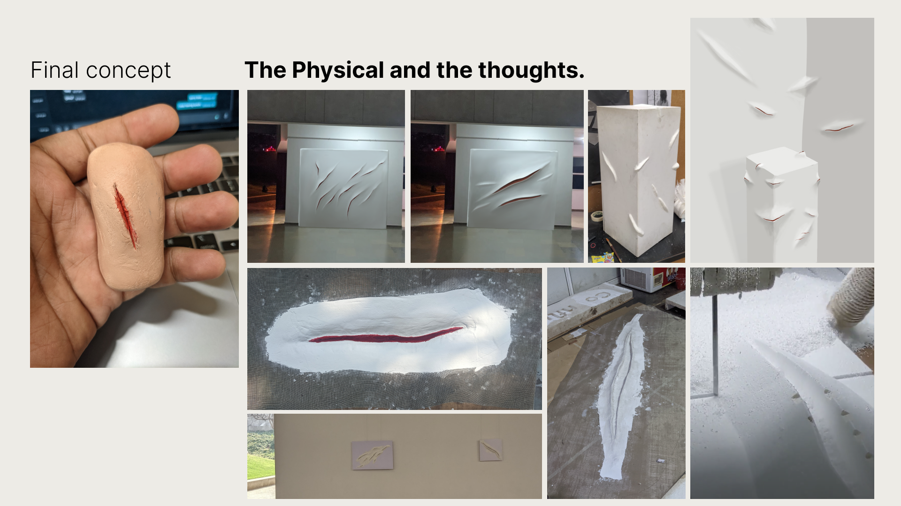

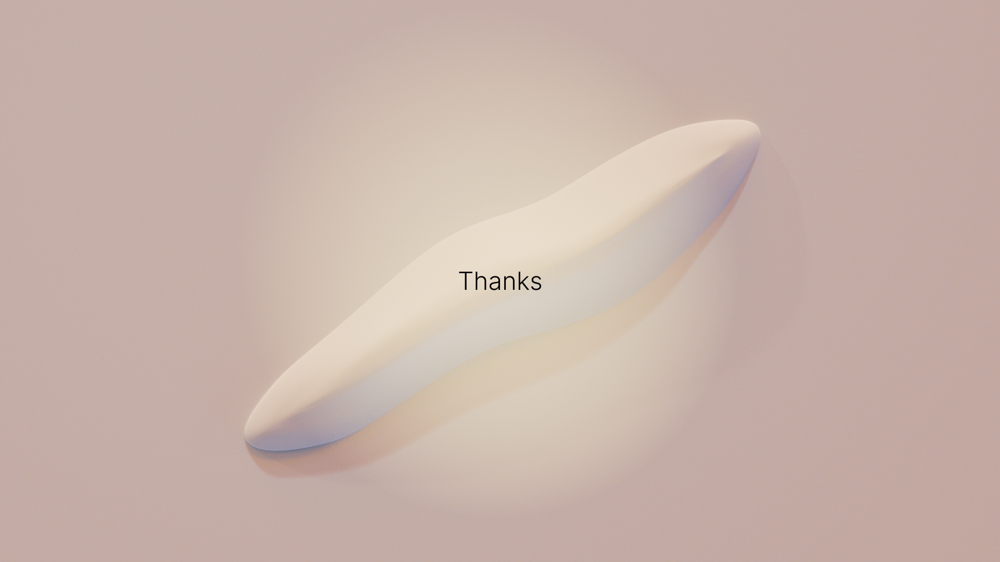 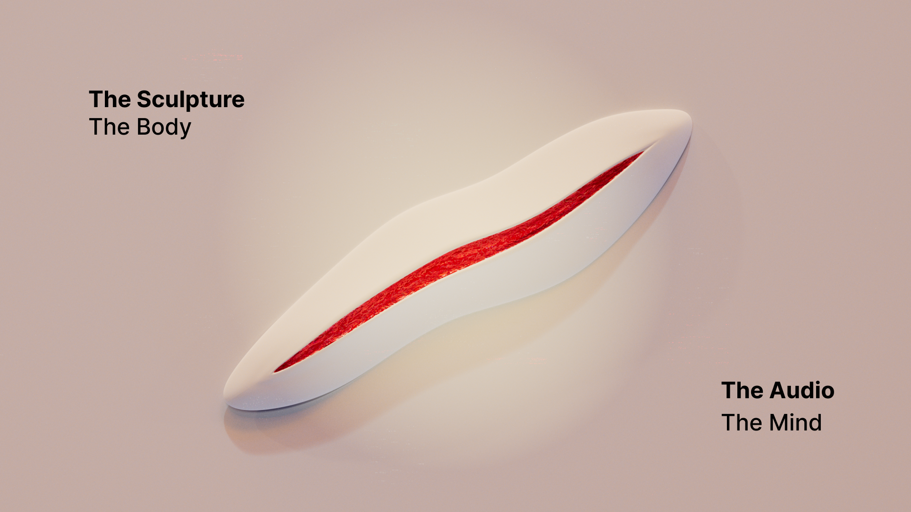

* * *

## [︎ Home](Portfolio_Home)

## [Next Project ︎](https://www.behance.net/gallery/35667399/%28-brazen-%29)

All rights Reserved. 2014 - 2022 | Dhruv Sanjiv Srivastava

