# Mibby

Original URL: /Mibby

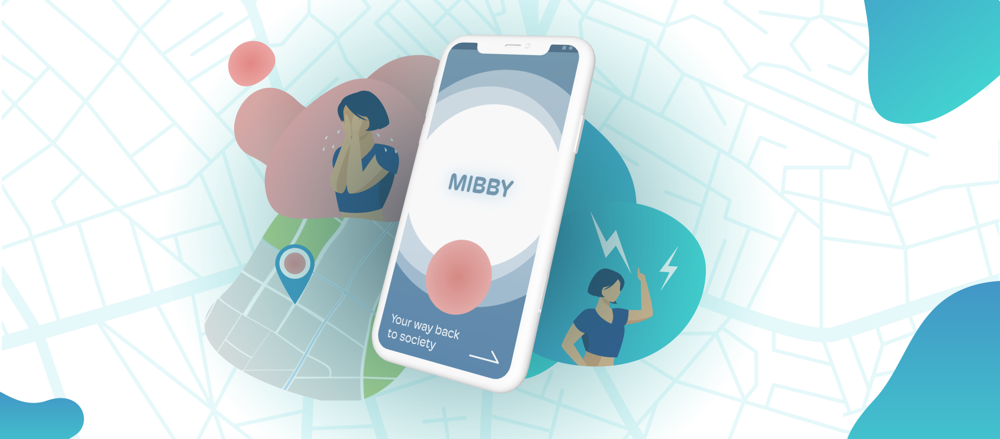

# Helping young adolescents break out of self isolation.

## | Exploratory Research | Problem finding | UX Design | VL Designathon | Interaction Design | Mental Health |

A project born out of the brief shared by ValueLabs wanted us to explore how Covid 19 has changed us, study its mental and psychological effects and design for a world that is rebuilding itself.

This project (_Mibby_) is an attempt to first seek and then solve for the problems arising due to extensive, compulsory self isolation. This has far reaching negative impact on the social and developmental skills especially in older adolescents or teenagers that have recently arrived at college or are headed to college.

**Team** [Janet Jacob](https://janetjacob.myportfolio.com/) & [Shreeya Patil](https://shreeyapatil.myportfolio.com/) (My very talented colleagues from New Media Design, NID)

**Role** Research + Interaction design

This project was selected in the **ValueLabs top 10** for the 2021 Designathon

## Methods explored

  * Exploratory Research

  * Rapid Field research

  * Mental model building

  * Quick Prototyping

* * *

## The pandemic has changed human behaviour. It began with the ask to isolate, then seek comfort in isolation. Now as the world opens up, we self isolate to seek comfort.

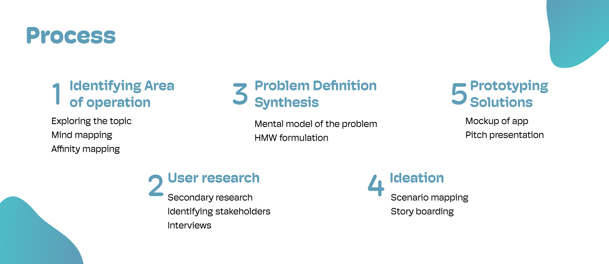

## Identifying Area of operation

To start out we brainstormed over a short session to identify the various aspects of Covid 19 related change people have observed. changes that spanned across behavior, society, group dynamics, psychological, businesses, physiology and economies.

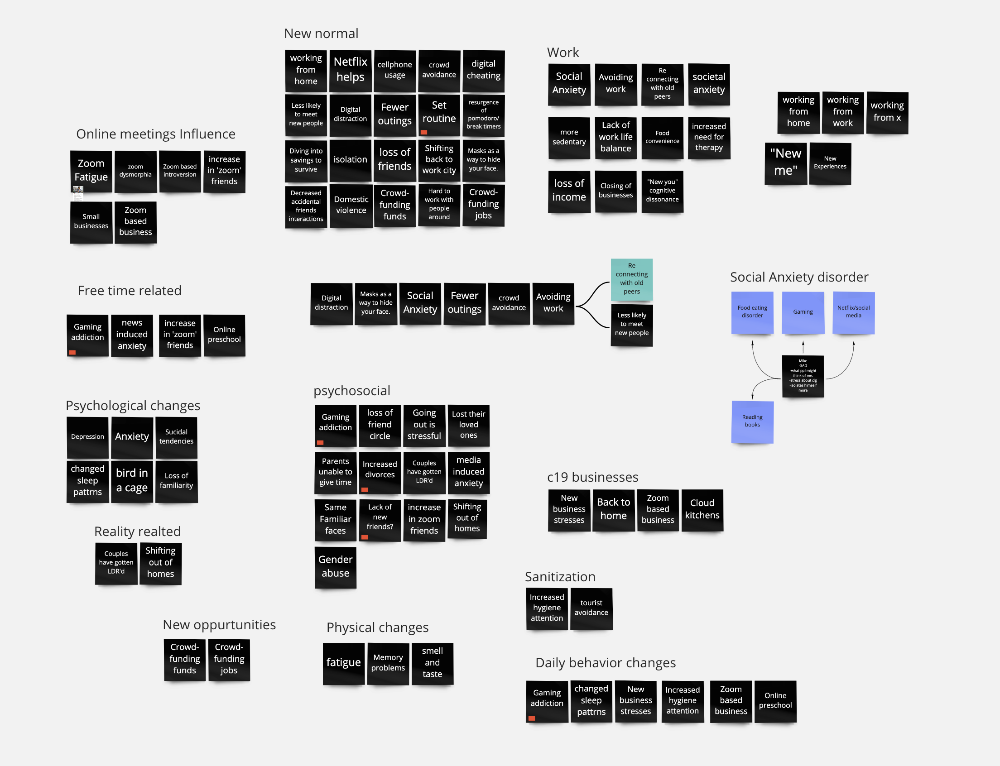 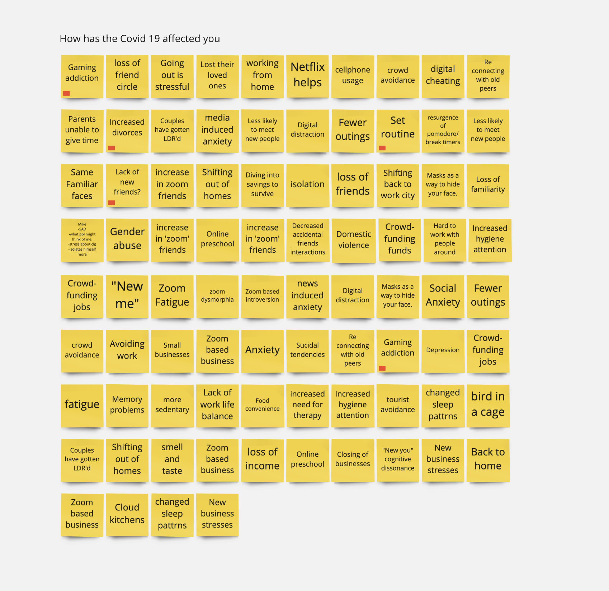

Insight: On Identifying Anxiety and social Isolation as the two keywords that were regularly recurring, we decided to take them ahead as the direction for the solution.

## We studied the different ways covid affected audiences at different levels.

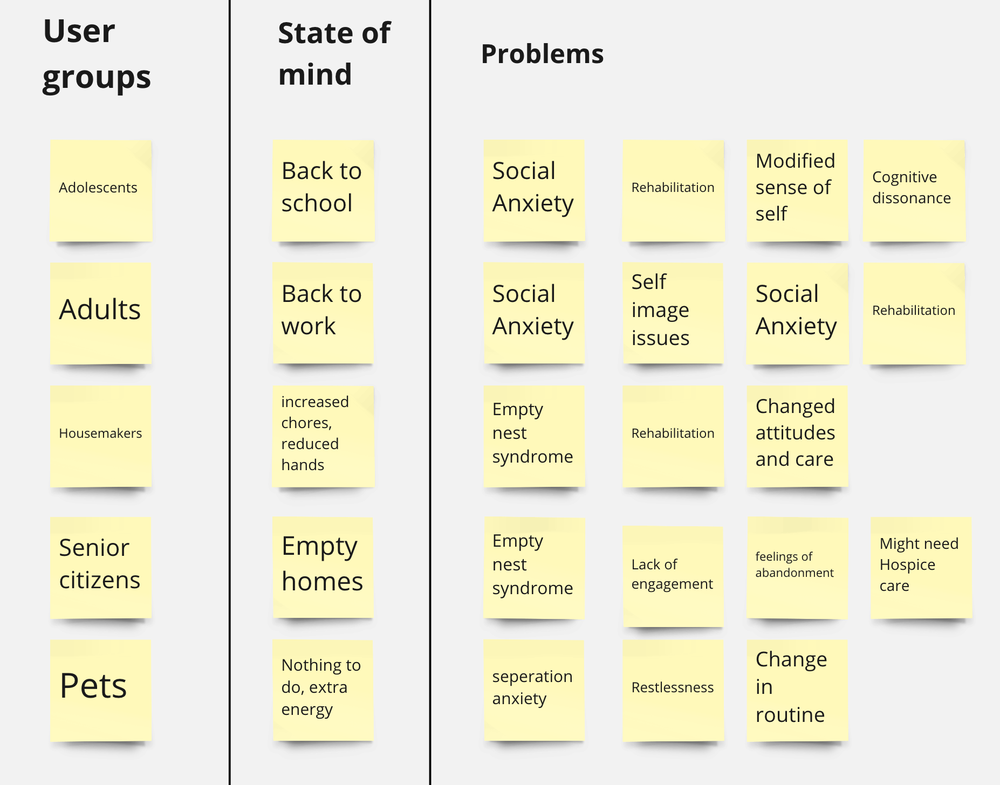

## Synthesis

We then built a mental model of the problem presented to simplify and understand the space we were operating within. As a part of understanding the keywords, we labeled the difference between positive self-isolation and negative self-isolation.

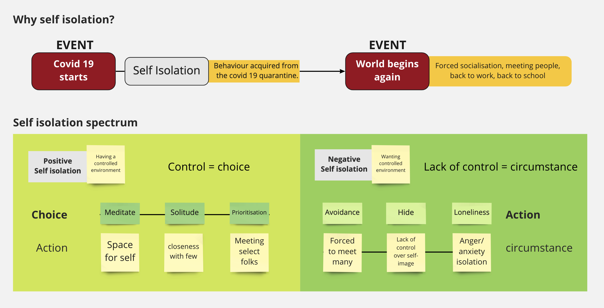

## Self Isolation isn’t inherently a bad thing, often it is a way to disconnect and step away from our daily engagements. It is an inherent activity that we do, be it taking a run or meditating. In a positive light it is often called “Me time or solitude”.

## When self Isolation is used as a coping mechanism in the face of a cognitive dissonant event, only then can it turn into a repetitive behavior and hamper emotional and personal growth in individuals.

We then identified the Target group that is the most likely to get face the adverse effects of self Isolation. **Older Adolescents.**

## Secondary Research

A full list of the secondary research can be found below.
 [Secondary research link here ︎](https://docs.google.com/document/d/11mNj8y675iFkwq_QqA5Cufw4XjXrvCOEVOBwgK-Y5zk/edit?usp=sharing)
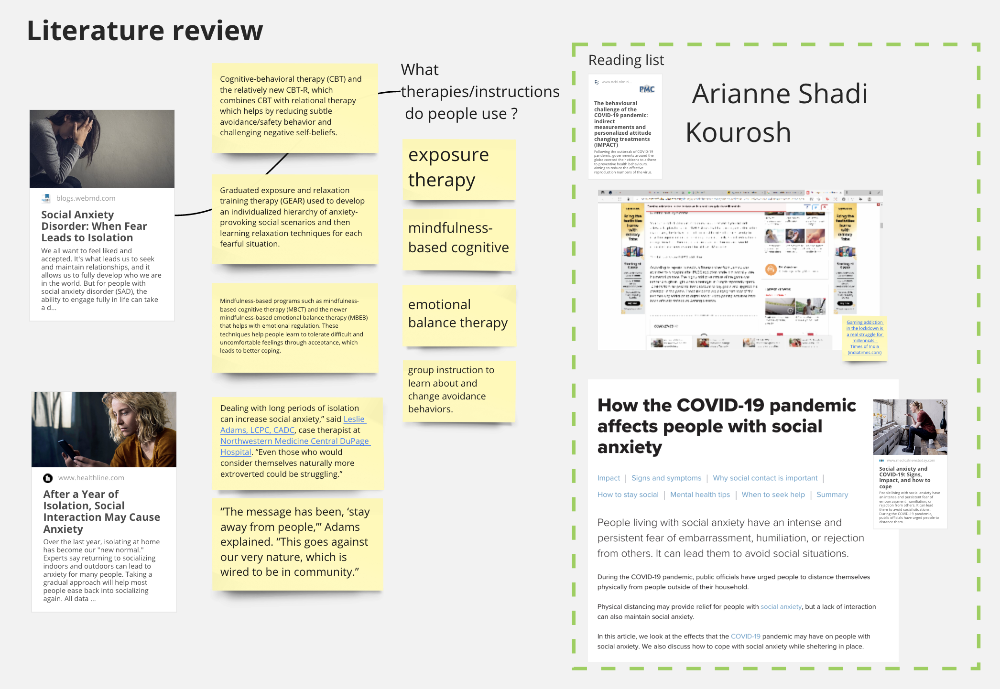

## Primary Research

**Understanding stakeholders**
We also conducted a set of interviews with adults that had recently stepped away from home, during the Covid 19 pandemic, on temporary basis. This was to understand their frame of minds and what were the kind of cognitive dissonances that they ended up facing.

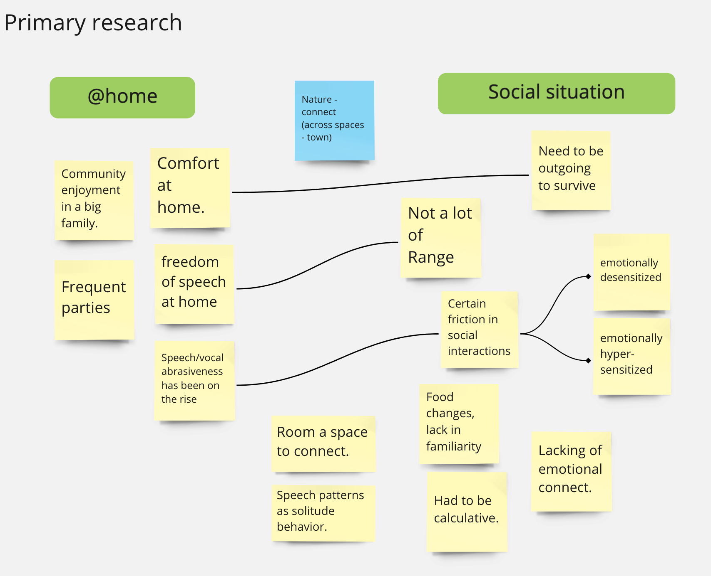 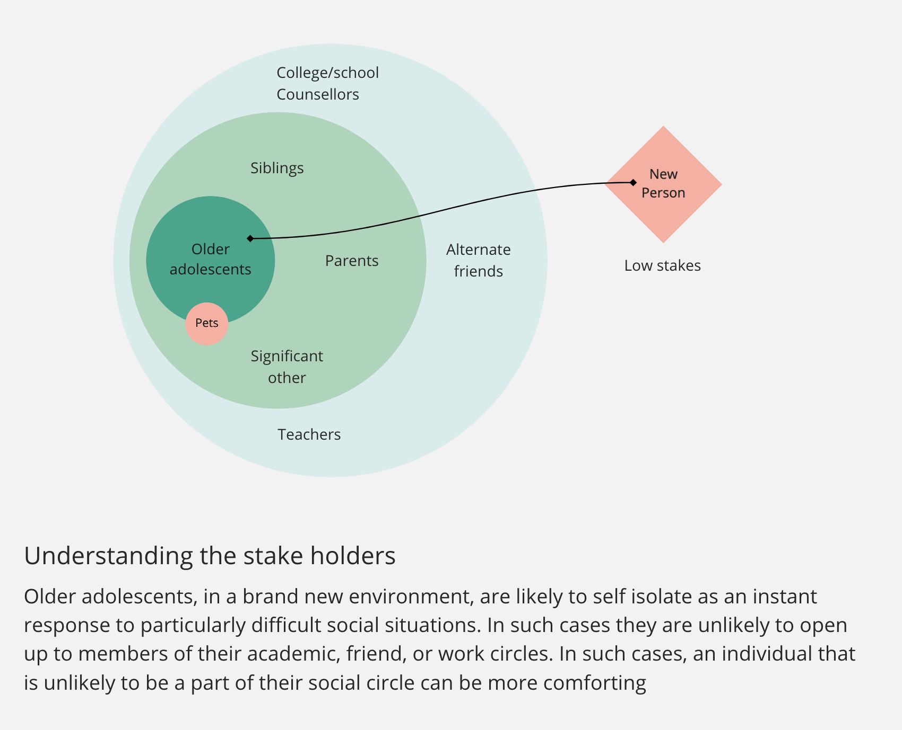

## Key Insights:

  1. Self Isolation at around the age of 16-19 leads to severly affected emotional development and early network building.
  2. Stepping out of home, almost every one faced problems with communication.
  3. Contrary to assumption, people felt the need to be outgoing even in the pandemic to maintain a level of relevance.
  4. We confirmed our theory of people retracting to their rooms in the face of excessive stress or anxiety.
  5. We Identified two types of people that drove these behaviors.
     1. emotionally desensitised folks
     2. emotionally hypersensitive folks

Based on these key Insights, we formulated our HMW statement.
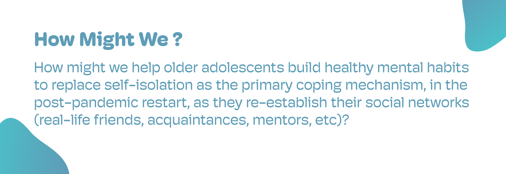

## Concept: Here are a few slides from the final solution presented at the VL Designathon 2021.
For the solution **Mibby**

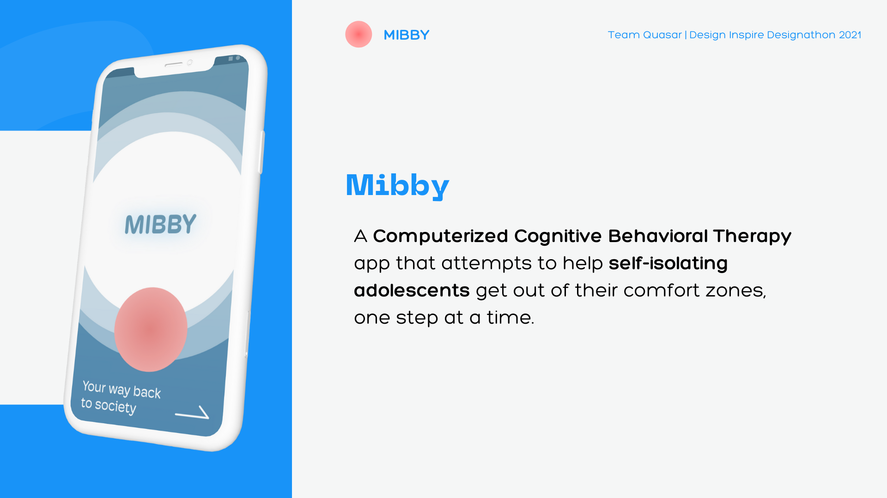
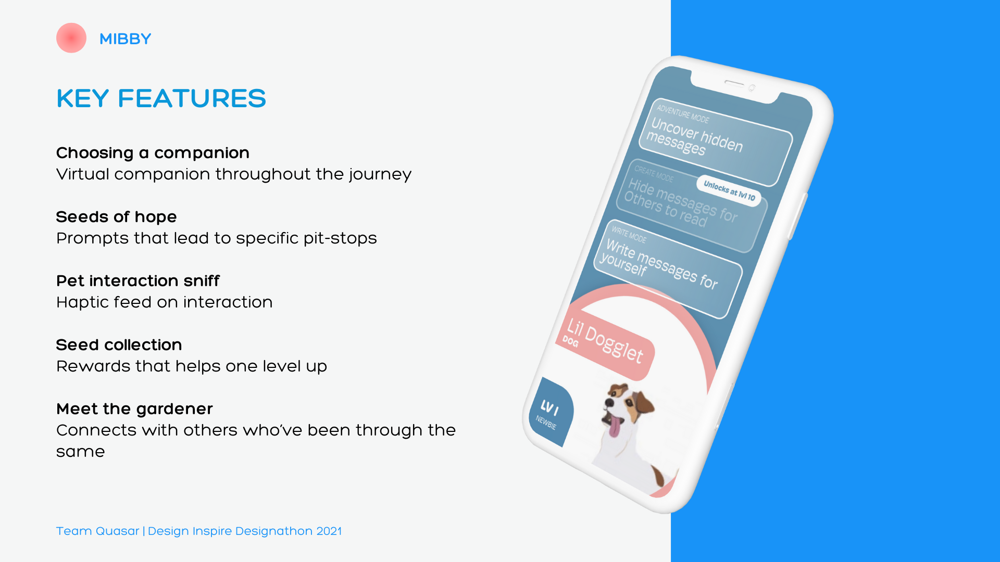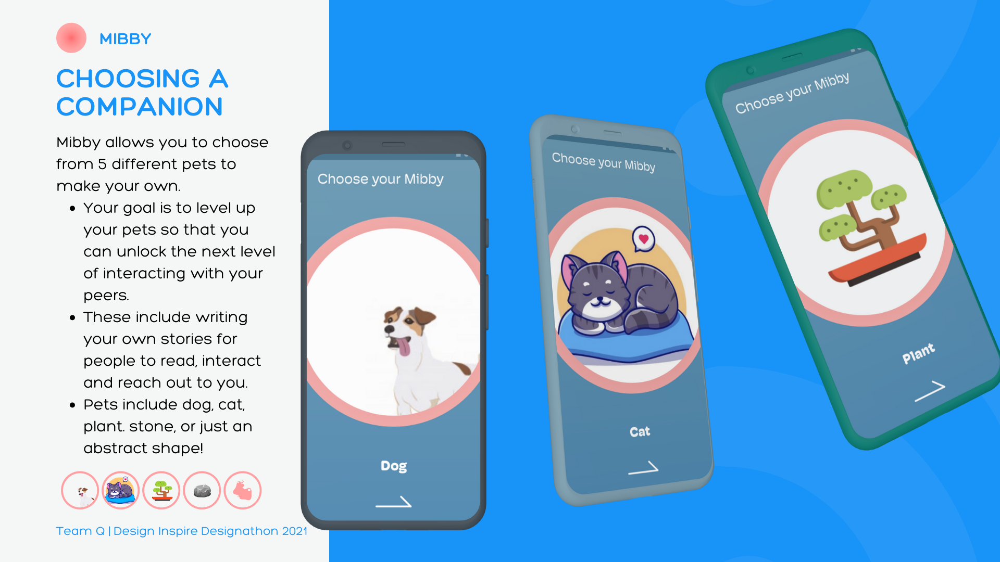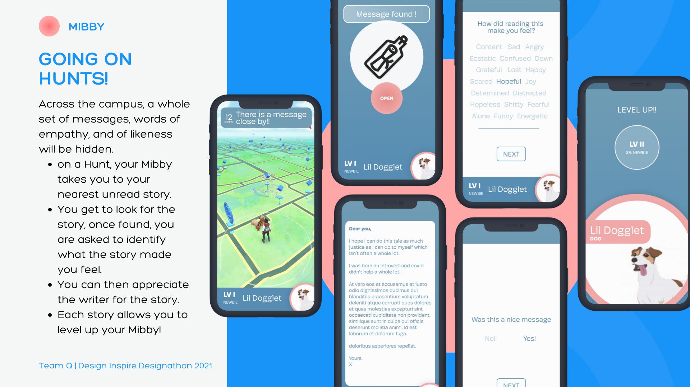
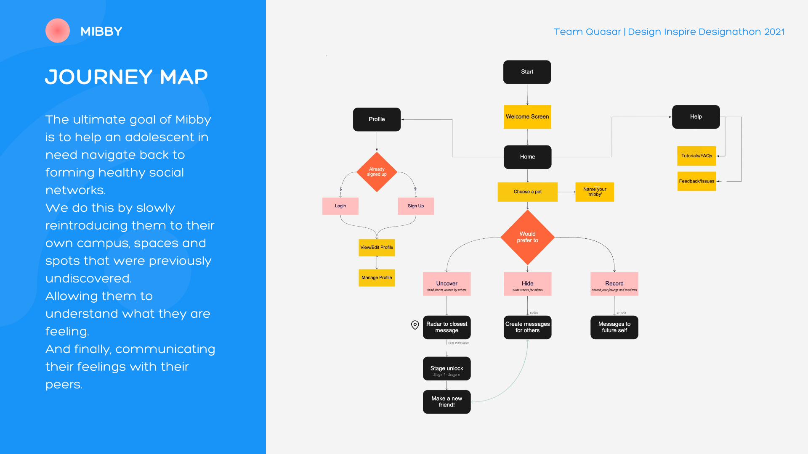
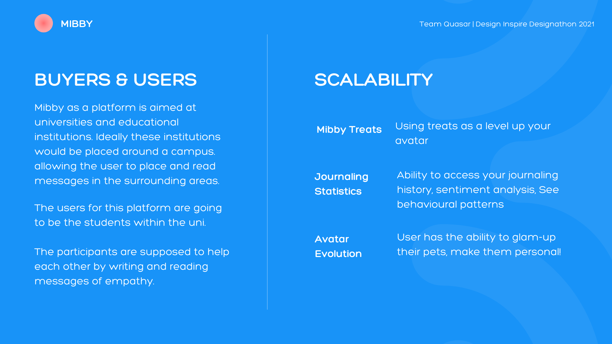

The Project exploration and updates are currently viewable at [quasarsmb.tumblr.com](http://quasarsmb.tumblr.com)
The initial project was completed in 24 hours, with final pitch presentation made over the course of a week.

* * *

## [︎ Home](Portfolio_Home)

## [Next Project ︎](Voice_Analytics_solution)

All rights Reserved. 2014 - 2022 | Dhruv Sanjiv Srivastava

