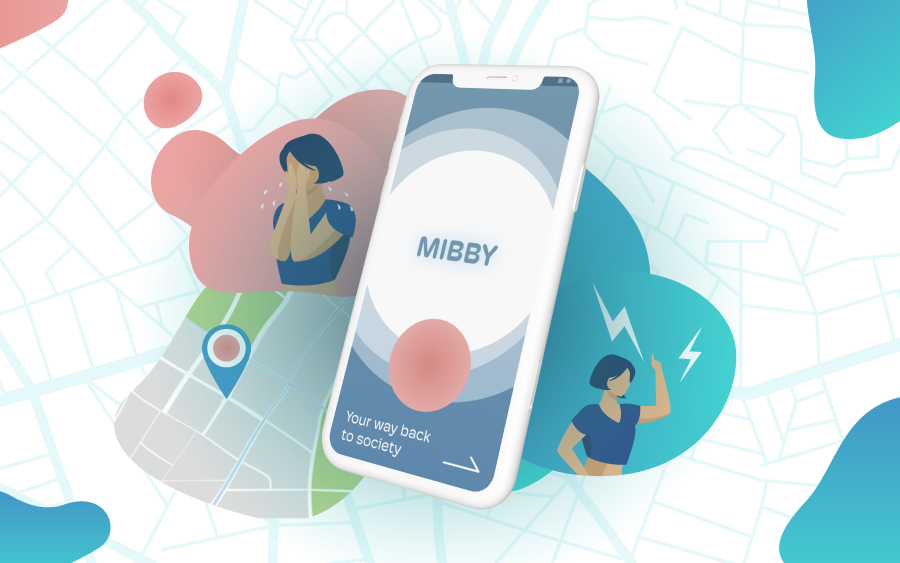
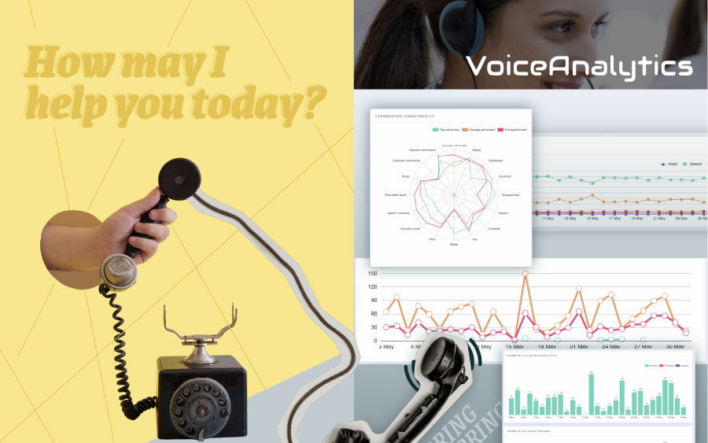
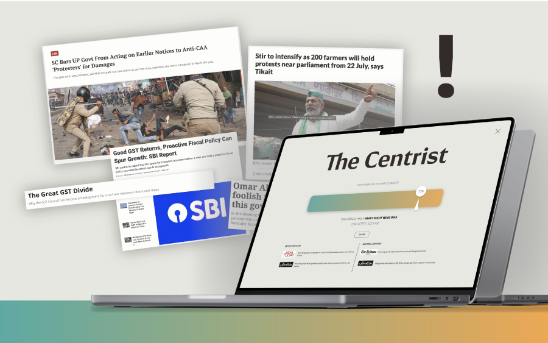
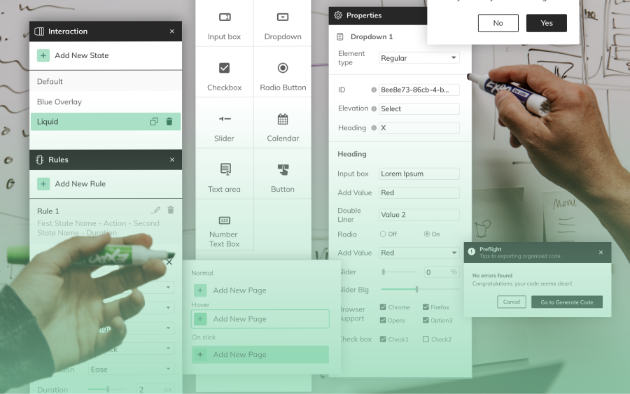
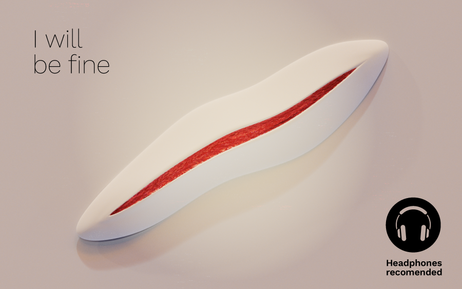
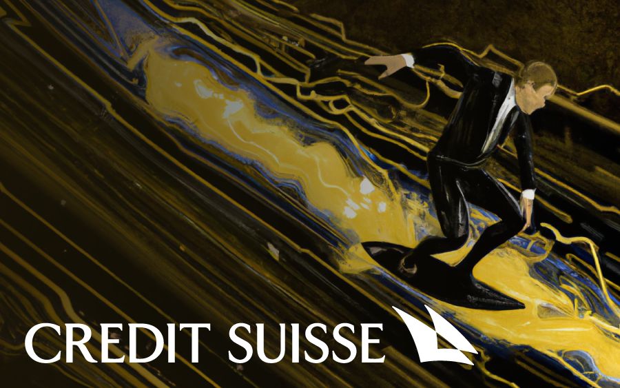

# Portfolio_Home

Original URL: /Portfolio_Home

# Hello there!

* * *

Nice to see you here!

I am Dhruv, a **digital product designer** with a passion for **working with data** and **making new tech accessible**.

I have over 4 years of product design experience at companies like [_Accolite_ ,](https://www.accolite.com/) [_Credit-Suisse_](https://www.credit-suisse.com/us/en.html), [_Deloitte India_](https://www2.deloitte.com/in/en/pages/risk/solutions/customer-experience-management.html) and [_Itu Chaudhuri Design._](https://icdindia.com/)

I’ve developed significant skills driving products from idea to execution. I enjoy **solving complex problems** and **experimenting across mediums**.

Have a look at

## **[My Resume](https://acrobat.adobe.com/link/review?uri=urn:aaid:scds:US:a9d4e31a-8062-3050-83de-2fe339a3367c) ︎︎︎**

## **[My Experiments  ︎︎︎](Experiment-Dump)**

* * *

# Projects

## [Helping older adolescents break out of self isolation. Designing for a post-covid world.](Mibby)

[Problem-finding | Social network | Older Adolescents | Mental health | Post-pandemic |
DESIGNATHON | ](Mii)[24 HOURS + 1 WEEK ](Mii)

## [Enabling better customer experiences with conversation design and voice analytics.](Voice_Analytics_solution)

| Linguistics | User Experience Design | Voice analytics | Conversation design |
LIVE PROJECT | 12 MONTHS

## [A crowdsourced news classifier to identify bias](The_Centrist) and fight polarization.

[| NLP | Linguistics | News | UX Design | Social Impact | New Media | GPT-3 | News Debates |](The_Centrist)
ACADEMIC PROJECT | 2 MONTHS

## [Building a No/low-Code Website builder for designers.](AmazeStudio)

| Product design | UX Design | User Research | Marketing & Branding | Strategy |
LIVE PROJECT | 6 MONTHS

## [I](I_will_be_fine) will be fine - an audio installation questioning identity and idea of the self.

[
| Staging | Experience design | Generative art | Boids | Sculpture | AR filters | New Media |
ACADEMIC PROJECT | 3 MONTHS](I_will_be_fine)

## [Sailing towards smoother banking with user-friendly products and design thinking.](Interning-Credit-Suisse)

[| User research | Design evangelism | UX Design | Design Thinking | Agile |
INTERNSHIP  | ](Interning-Credit-Suisse)[6](Interning-Credit-Suisse) MONTHS

## **[_View my Experiments page_](Experiment-Dump)**

# ︎Thanks for visiting !︎

All rights Reserved. 2014 - 2022 | Dhruv Sanjiv Srivastava
