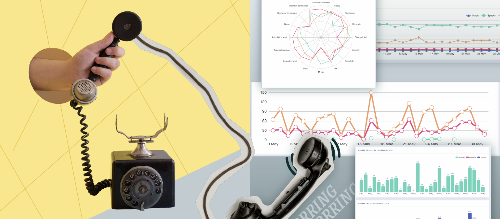
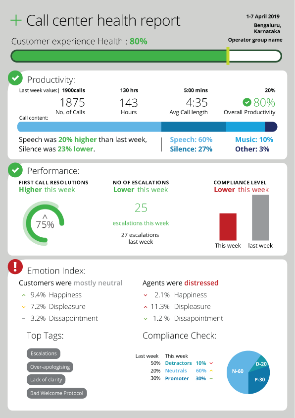
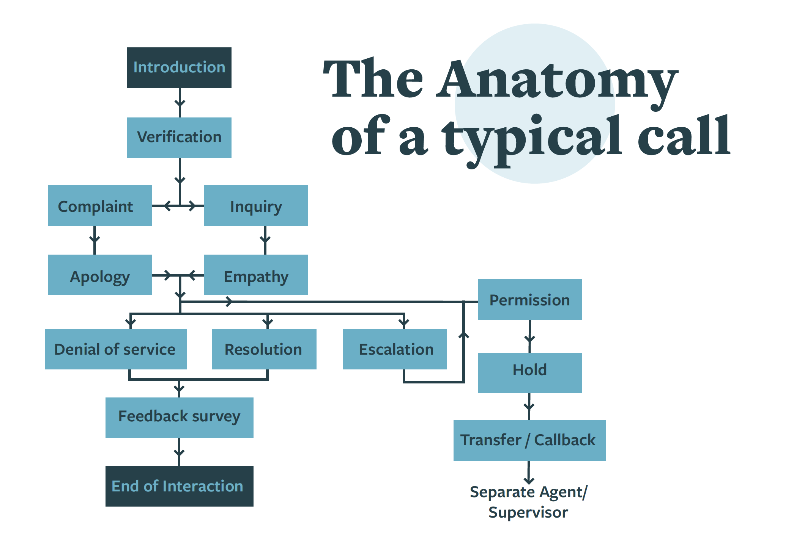
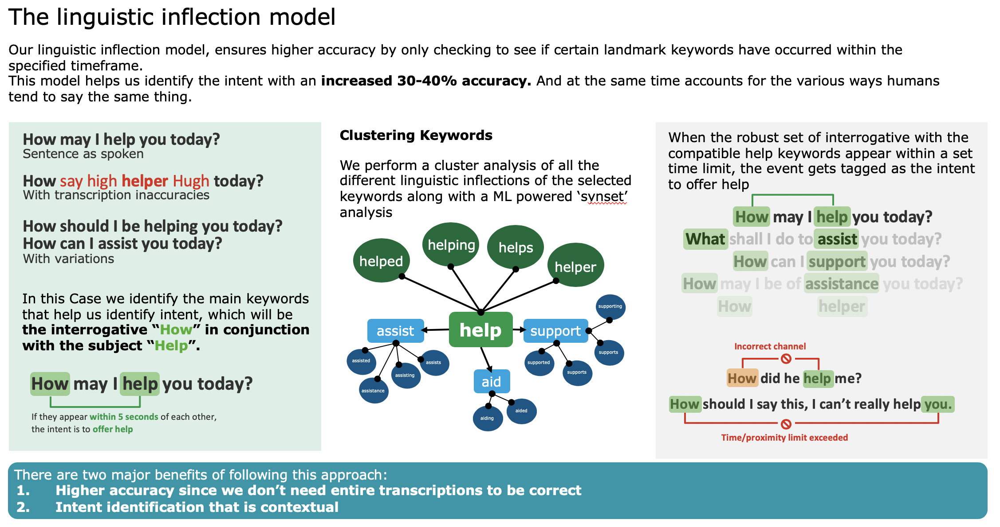
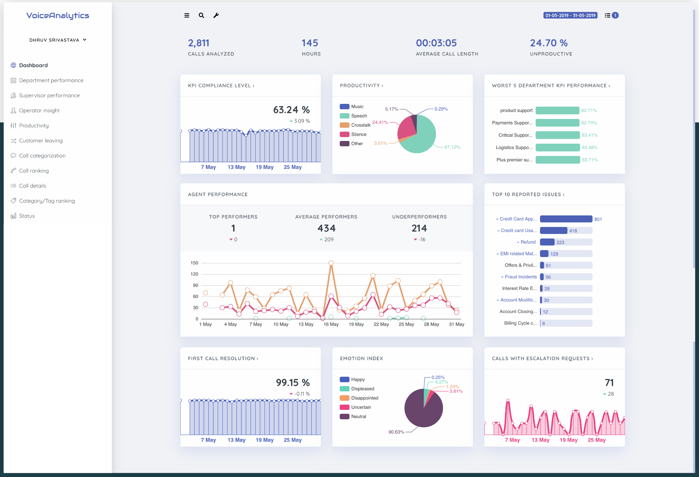
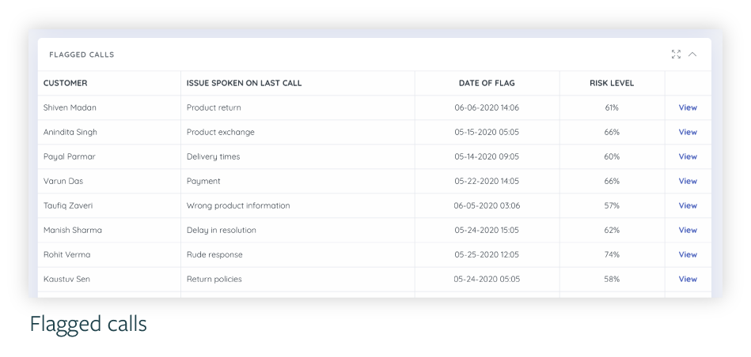
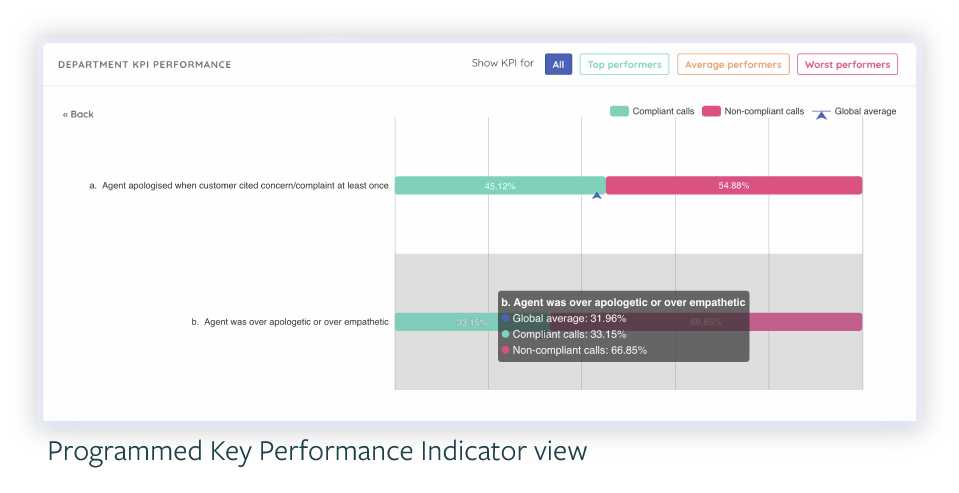

# Voice_Analytics_solution

Original URL: /Voice_Analytics_solution

# Enabling better customer experiences with conversation design and voice analytics.

## | Linguistics | Journey Mapping | User Research | User Experience Design | Voice analytics | Conversation design |

In January of 2019, ︎︎︎︎︎︎︎︎* wanted to expand their set of capabilities offered to their clients. This expansion would include a service that helped do Customer experience audits, but in a holistic manner that would monitor all possible customer touchpoints.

I had the opportunity to be one of the first members within this team, working on the Voice Analytics (VA) solution.

My responsibilities included leading the research efforts in finding problems worth solving, mapping customer journey and building a frameworks for these calls, Identifying areas where digital transformation could augment the process, identifying KPIs and building a CXO level dashboard that provided actionable insights.

*Due to the nature of the contract, some of the information here has been redacted.

**Client  **A Big–4 Consultancy (Due to an NDA, I am unable to name the company)
**
Role **Lead Consultant, working with a team of 3, reporting directly to the solution leader. worked in tandem with a production team based out of the EU.
**
Timeline **April 2019 - Sept 2020

## Key learnings

  * Customer experience audits, Journey mapping and core UX in a business setting.
  * Breaking down linguistics workflows for indic languages.
  * Identifying KPIs that could be used to measure customer experiences
  * Working with ML engineers to build a robust system that did better transcription for indic scripts.
  * Working with data scientists to create dashboards that highlighted KPIs
  * Observing the growth of a small team to a medium size, and a service from idea to POC.
  * Preparing and giving pitch presentations to client side and customers.

* * *

## The Brief was to create a SaaS based solution that automated the Quality Assurance for call centers, while monitoring all the calls.

While here, I had the opportunity to work with various technologies, and understand their place within a business. I primarily worked on the Voice Analytics segment, successfully executing a POC and adapting the solution for various sectors.

## Tech under the hood

A voice analytics software primarily takes the call center audio file and analyses it to give the following outputs:

**Call transcript based insights** The tool transcribes the call for both channels, this in turn helps us derive events that have taken place on the calls.

**Call sentiment based insights** The tool identifies the tone of voice and flags the ones with the medium-high probability, which then gives an understanding of the softer aspects of the conversation.

**Speech marker based insights:** The tool also looks at things like rate of speech based on phonemes per second, Level of articulation, etc. along with music, speech, crosstalk and silence periods

* * *

## Process

  * The Busy-eyes Report Pilot.
  * Understanding the technologies under the hood.
  * Conducting User research (Journey mapping, breaking down the call flow, building a frame work)
  * Conducting linguistic and audio analysis.
  * Synthesis and visualisation of data.
  * Designing conversational flows, and setting speech guidelines.
  * Working on the Voice Analytics Dashboard.

## The Busy-eyes Report Pilot.

One of the things I worked on was the ‘Busy Eyes’ report which would be a physical version of the dashboard report.

The ‘Busy Eyes’ report was a weekly report that would provide the business an oversight into how the call center was doing. This idea was further evolved to incorporate the department-wise breakdown and the reason for calling breakdown.

The idea of these reports were modular. It would work from the ground level right up to the CXO levels.

This concept laid the foundation of the main dashboards that were eventually created as a part of the solution.

## Understanding and mapping the flow of calls

Our Research consisted of the following methods

> Quantitative analysis of the calls based on the basic metadata available.
> Qualitative analysis of upto a 100+ calls to identify calling patterns.
> Role-playing as customers to identify how special cases were handled.
> Fly-on-the wall observation of the call operators.
> Conducted Interviews with customers, operators and business  teams etc.

## Synthesis

Based on the data collected, we managed to identify multiple CX painpoints.
Pain points such as: Over apology, no greetings, taking too long on call, greeting with a negative tone of voice (based on ML- sentiment analysis), etc.

With the help of this, we created an ideal flowchart of what is to be done at what level for each solution, we used this data to build over **14 KPIs and 35 Rules** that drove the solution.

## Helping build an Indic transcription engine

During this engagement, one of the tasks we had to do was build a dictionary of words that were to be boosted on the Transcription engine. These words included individual words, phrases to full sentences as well.

## The malleability of the spoken word

The linguistic analysis of these calls, especially the Hindi and Marathi calls lead to a robust dictionary of phrases being generated. But language is flexible, and to highlight the many ways one can speak a sentence, we had to get creative.

 The linguistic inflection model was one of my key contributions while at the VA team.

## Building a dashboard

We partnered with Hungarian company who would serve as our platform partners to design their platform for the needs of an Indian call center

This was a thorough exercise over the course of **2 months** that included constant to and fro with the developers to give our clients exactly what was needed. The solution created can be explored [here.](http://VoiceAnalytics.io)

The dashboard gave us a list of customers with recurring calls and negative emotions. it also looked at the customers with the most amount of escalations. There was also the scope of co-relating this information with the client-side database and arriving at high risk and low risk customers based on the spends-to-complaints proportion.

## Proof of Concept

With over 14 KPIs and 35 Rules at hand, we took up a POC with one of India’s largest e-commerce. Analysing over 16,000 calls, 458 agents in English, Hindi and Hinglish.

Over the course of the 4 month long POC, we were able identify process gaps and behavior modifications that were currently leading to poor CX.

**One of the main findings was that 66% calls had over empathising agents**

The client had been training agents to apologise in case of any complaint being mentioned with words like '**निश्चिन्त** ' or ‘**पूरी सहायता** ’. While the right response would’ve been to help the customer by solving his issue directly after acknowledging it once.

  

A VA solution Dashboard outling a typical call center situation

## What I learned

Eventually, as the team grew my role evolved into acting as a bridge between the technology team, the business team and the clients along with slight dabbles into cloud architecture, ML.

Being the only one with a design background in the team, bringing the design-thinking structure into the team often became my role. This helped me identify my weaknesses and work on them in any consecutive project that I under took.

As mentioned earlier, a large part of this is under an NDA. I’d be delighted to answer any questions in person if required.

* * *

## [︎ Home](Portfolio_Home)

## [Next Project ︎](The_Centrist)

All rights Reserved. 2014 - 2022 | Dhruv Sanjiv Srivastava

